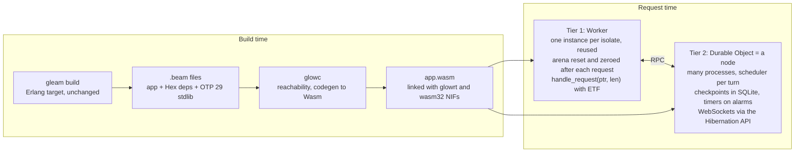

# GlowVM AOT spike: BEAM → Wasm on workerd

Nov 9, 2026

## Goal and success criteria

The spike proves that ahead-of-time compiling `.beam` files to Wasm, with a small Rust runtime, beats glowvm on real workerd. It must work for request-scoped handlers (tier 1) and persistent processes on Durable Objects (tier 2). Containers are out: Giolt stays BEAM on the edge.

The spike passes only if every row below holds, measured on workerd (`wrangler dev` locally, then a deployed Worker), on the same fixture, side by side with glowvm. The targets are proposals; tune them once Phase 0 gives real baselines.

| Measure | How | Target vs glowvm | glowvm baseline (Phase 0, deployed) | glowc must hit |
| --- | --- | --- | --- | --- |
| CPU per request, trivial handler (`basic_get`) | p50 and p99 over 5k requests (cut from 10k for the Free plan's daily limit) | at least 3× lower | p50 4.13 ms, p99 13.94 ms | p50 ≤ 1.38 ms, p99 ≤ 4.65 ms |
| CPU per request, heavy handler (`lustre_html` render, a JSON round trip) | p50 and p99 | at least 5× lower | `lustre_html`: p50 4.02 ms, p99 13.41 ms. JSON round trip: not measured yet | p50 ≤ 0.80 ms, p99 ≤ 2.68 ms |
| Isolate startup, including warm-up | workerd startup timing, first request after deploy | no worse | startup 22 / 21 ms; first request 81 / 68 ms server time, 5.6 / 4.7 ms CPU (`basic_get` / `lustre_html`, medians of 5) | ≤ the same |
| Worker bundle size | compressed upload size | no larger than glowvm.wasm (455 KB) + app.avm | 298.73 KiB / 316.50 KiB gzip (823.58 / 860.82 KiB raw) | ≤ the same |
| Peak memory per request | wasm memory high-water mark | lower | 576 KiB / 640 KiB (9 / 10 pages, fresh instance per request) | lower |
| Correctness | every fixture the spike covers | byte-identical status, headers and body to glowvm |
| Tier 2 persistence | gen_server counter in a Durable Object | state survives DO eviction and a redeploy (via `code_change`) |
| Tier 2 messaging | send to a process in another DO and get a reply | round trip measured and reported, no target yet |

No row is traded against another: a faster runtime that breaks a fixture fails the spike.

## Baseline: how glowvm runs a request today

glowvm interprets BEAM bytecode inside Wasm and boots a fresh VM for every request. That per-request boot and the interpreter loop are the two costs the spike has to remove. From `withgiolt/glowvm` (`priv/index.js`, `native/src/main.c`, `src/glowvm/internal/bridge.gleam`):

1. `index.js` encodes the request as an Erlang external term (ETF) tuple `{Method, Url, Headers, Body}`.
2. `runWasm` creates a new `WebAssembly.Instance` of `glowvm.wasm` (AtomVM built for `wasm32-wasi`, 455 KB) and mounts `app.avm` in a virtual WASI filesystem.
3. AtomVM's `main` starts the VM, parses the PackBeam and loads every module, then runs the app's `start/0`.
4. `glowvm.serve` reads the ETF request from stdin, decodes it into a `wisp.Request`, calls the handler and writes a framed ETF response to stdout, ending in `__GLOWVM__`.
5. `index.js` finds the last sentinel, decodes the response and returns it.

What is already optimised, and must not be counted as a spike win:

- The compiled `WebAssembly.Module` is reused across requests, and a module-scope warm-up request moves V8's lazy compile (about 20 to 30 ms of CPU) into isolate startup.
- ETF instead of JSON for the bridge, because JSON encoding in interpreted Erlang took about 15 ms for a 30 KB body.

What is still paid on every request: a new instance and fresh linear memory, AtomVM boot, PackBeam parse and module load, interpreted bytecode, and the ETF round trip through stdio. Known gaps (README): 64-bit integers only, no `crypto` beyond `strong_rand_bytes`, grapheme functions treat codepoints as graphemes, partial case mapping, limited non-byte-aligned bitstrings, and crashes that report as `Failed load module: init.beam`.

The benchmark harness reuses glowvm's own `fixtures/app` (`basic_get`, `echo_body`, `lustre_html`, `stdlib_*` and the rest) and `scripts/smoke.test.ts`, so both runtimes are measured on identical inputs.

## Architecture

A Rust compiler, `glowc`, turns the app's `.beam` files and the real OTP stdlib `.beam` files into one static Wasm module, linked with a Rust runtime, `glowrt`. Nothing is interpreted, and nothing is loaded at request time.



Everything up to `app.wasm` happens at build time. At request time nothing is parsed or loaded, and a process in a Worker can message a process in a Durable Object over RPC.

### Pipeline

1. `gleam build --target erlang` runs unchanged. No Gleam fork; Erlang and Elixir deps work the same way.
2. `glowc` reads every `.beam` the app can reach: the app, its Hex deps, and OTP 29's own `stdlib`/`kernel` ebin files. It parses the chunks (`Code`, `AtU8`, `ImpT`, `ExpT`, `LitT`, `FunT`, `Line`) and decodes BEAM's compact term encoding into an IR, one function at a time.
3. Whole-program reachability from the entry `handle/1`. Unreached functions are dropped. Calls through `apply/3` or unknown funs keep their whole export table reachable, and the compiler reports which ones did.
4. Codegen to Wasm with the `wasm-encoder` crate. The atom table and every literal from `LitT` go into data segments, built at compile time, so startup parses nothing.
5. Link with `glowrt` (built for `wasm32-unknown-unknown`) and any NIF objects (also wasm32), then run `wasm-opt`. Outputs: `app.wasm`, plus a Worker entry and a Durable Object class in JS.

### Calling convention and suspension

The design leans on one BEAM guarantee: anything live across a call or a `receive` is already in a Y register, on the process stack. X registers are dead after a call returns, apart from the result.

- Each BEAM function becomes a Wasm function `(proc: i32, x0..xN: i64) -> i64`. X registers are Wasm locals. Y registers live in a stack frame in linear memory, exactly like BEAM.
- `call_last` / `call_only` become `return_call`, so Gleam's recursion-as-loops runs in constant stack.
- A call returns either a term or the non-value marker, as ERTS BIFs already do. After every call that may fail or suspend, generated code checks for the marker: one predictable branch.
- Exceptions: the callee sets the process's exception state and returns the marker; callers unwind to the nearest `try`.
- Suspension: a `receive` with an empty mailbox stores a resume label in the current frame and returns the marker. Each caller on the way out stores its own label in its frame. To resume, the scheduler re-enters the top frame's function, and a `br_table` at the function's entry jumps to the label.
- Calls to functions that can never suspend skip the label store. Most handler and stdlib code is in that group, found by whole-program analysis.
- A suspended process is just its heap plus its stack of `(label, Y registers)` frames in linear memory. It can be copied out byte for byte, which is what tier 2 needs. JSPI and Asyncify are not used for processes.

### Terms and memory

- Terms are 64-bit tagged words (`i64`), following ERTS's tagging closely enough that `erl_nif.h` and ETF map directly. Pointers inside them are 32-bit offsets into linear memory.
- Small integers are 60-bit, with heap bignums above that. This removes AtomVM's 64-bit limit.
- Boxed values: tuples, floats, bignums, funs, maps (flat map up to 32 keys, HAMT above), heap binaries up to 64 bytes, off-heap binaries in the request arena, sub-binaries and match contexts.
- Atoms known at compile time are fixed indices. `binary_to_atom` appends to a runtime table.
- Each process gets a heap and a stack in linear memory, with a copying minor GC when its heap fills.
- One instance per isolate, reused across requests. At the end of a request the arena's bump pointer resets and the used range is zeroed, so one request's data can't leak into the next. Most requests never reach a GC.

### BIFs, NIFs and the host

- `glowrt` implements in Rust the erts BIFs and NIFs the reachable code calls: guards and `erlang:*`, `term_to_binary`/`binary_to_term`, the `lists`, `maps` and `unicode` NIFs, bignum arithmetic and binary construction and matching.
- Everything written in Erlang comes from OTP's real `.beam` files. glowvm's `string`, `maps`, `base64` and `json` shims are not carried over, so graphemes and case mapping become correct for free.
- NIF ABI: `glowrt` exports the `erl_nif.h` functions. A NIF's C or Rust source is built for wasm32 and linked statically. `ERL_NIF_INIT` registers its functions in the compile-time export table.
- `crypto` comes from Rust crates (`sha2`, `hmac`, `getrandom` on the host's `crypto.getRandomValues`), so it stays synchronous. That unblocks `gleam_crypto` and wisp's signed cookies.
- Host boundary: JS writes the request as ETF into linear memory and calls an exported `handle_request(ptr, len)`, which returns the response's `(ptr, len)`. No WASI, no stdio, no sentinel. glowvm's ETF request and response shapes are kept, so the benchmark compares runtimes, not bridges.

## Phase 0: verify workerd first (2 to 3 days)

The design above assumes features nobody has yet confirmed on workerd. Each check is a hand-written `.wat` file or a 20-line Worker, run under `wrangler dev` and then deployed. One hard failure changes the design before any compiler code exists.

Local results, 2026-11-09, from `glowc-phase0` (`./build.sh`, then `node probe.mjs <config> <paths...>`). Every probe was then deployed to the Giolt account (Workers Free, colo OTP) and gave the same results; the differences are noted per item.

- [x] Pin the `wrangler` and `workerd` versions and record the V8 version they embed.
  - wrangler 4.159.0 (exact pin), workerd 1.20261109.1 (`workerd --version`: 2026-11-09), V8 15.8.62.5 (from `strings` on the binary; `process.versions.v8` is blank inside the Worker). compatibility_date 2026-11-01, only flag `nodejs_compat`.
- [x] Tail calls: a mutually recursive `return_call` pair running 10 million iterations finishes without a stack overflow. Must pass: without it every Gleam loop needs a trampoline.
  - `/tail?n=10000000` returns 10000000 for both the re-encoded and the `-Oz` build, 21 ms wall. Negative control: the same pair with `call` passes at n=1000 and throws `RangeError: Maximum call stack size exceeded` at 10M. `-Oz` merges the pair into one self `return_call`, so the re-encoded build is the real mutual-recursion test.
- [x] The Wasm features `glowc` will emit (`bulk-memory`, `multivalue`, `sign-ext`, `nontrapping-float-to-int`) validate with no `v8_flags`. glowvm's build script already found that workerd rejects some newer encodings, so test the exact `wasm-opt` output, not just the source.
  - `/features` returns the expected 2147483819 for both wasm-opt outputs, with no `v8_flags`. `-Oz` inlines multivalue away; the re-encoded build keeps it.
- [x] Code is imported, not compiled at runtime: the `.wasm` is bundled as a module import, and an instance created at module scope is reused across requests. Confirm workerd keeps that instance and its memory between requests in the same isolate.
  - Three `/bump` calls return 1, 2, 3 with one isolate id: instance and memory persist. Deployed, the three calls hit two isolates (1, then 1 → 2 on the second isolate): reuse holds per isolate, but requests can spread across isolates, so warm state is not guaranteed. Runtime `new WebAssembly.Module(bytes)` fails with "Wasm code generation disallowed by embedder", so module imports are the only way in. Gotcha: `crypto.randomUUID()` at global scope is rejected ("Disallowed operation called within global scope"); `new WebAssembly.Instance` at global scope is fine.
- [x] `i64` across the JS boundary arrives as `BigInt` with no extra flag. It's only needed for the host imports.
  - `/i64`: the export returns `bigint`, the import receives `bigint`, and 2^62 round-trips with the expected i64 wraparound.
- [x] Wasm exception handling (`try_table`) is present. Optional: it's an alternative to the marker check, to measure later, not a dependency.
  - exnref `try_table` and legacy `try`/`catch` both catch a tagged i64 thrown through a JS import (result 42), re-encoded and `-Oz`.
- [x] JSPI: record whether `'Suspending' in WebAssembly` is true. Informational only. Processes don't use it, but it decides how outbound `fetch` from Erlang code can work later.
  - True; `WebAssembly.promising` exists too. Not exercised yet.
- [x] Durable Objects under `wrangler dev`: SQLite storage, `setAlarm`, and RPC between two DO classes all work locally.
  - SQLite upsert counts 1, 2, 3; a 500 ms alarm fired (checked after 2 s); `Caller` → `Counter` RPC works, about 1 ms measured in the caller.
- [x] Measurement: find a CPU-time source per request that both runtimes report the same way. Deployed Workers don't advance timers during pure compute, so timing inside the Worker isn't trustworthy. Use per-invocation CPU time from Workers observability or a Tail Worker as the source of truth, and confirm what `wrangler dev` can show locally.
  - `wrangler dev` logs wall time only (`GET /tail 200 OK (21ms)`), no CPU time.
  - Tail Workers need Workers Paid; the Giolt account is on Free (error 100150).
  - `wrangler tail --format json` has `cpuTime` per invocation, but in whole ms and sampled: it kept about 8% of events even at 25 req/s.
  - Chosen source: Workers Analytics GraphQL, `workersInvocationsAdaptive` cpuTime quantiles (µs), filtered by `scriptVersion` and the exact window of the measured run (`bench/analytics.mjs`). New scripts show as `__unknown__`, so filter by version, not name. Counts are adaptive-sampled estimates. Needs an API token with Account Analytics: Read.
  - Deployed timing gotcha: the DO RPC round trip measured inside the caller is about 35 ms deployed against 1 ms locally.
- [x] Baseline numbers: deploy glowvm's `basic_get` and `lustre_html` fixtures and record p50/p99 CPU, startup, bundle size and memory. These fill the targets in the first table.
  - glowvm commit 7190ebc, `fixtures/app/dist` copied unmodified, entry `index.min.js`, compatibility_date 2025-08-06 and no flags (giolt's upload settings), `.avm` as a Data module. Results are in the first table; raw data in `bench/results/`.
  - Procedure: 1,000 warm-up requests, then 5,000 measured at concurrency 10 and 25 req/s with `oha`, three runs, median of the runs' p50 and p99. Cold start: 5 fresh deploys per fixture, first request timed. Memory: a local instrumented copy (`bench/glowvm-mem`) that reads `memory.buffer.byteLength` after `_start`.
  - Reference responses (status 200): `basic_get` body sha256 a93e435a… (17 B), `lustre_html` 24f3e3de… (81 B), with headers saved next to them.
  - The Giolt account also serves production Workers (`giolt`, `giolt-dash`, `gote`), which share the Free plan's daily request limit. Keep benchmark load small.

Exit: every "must" passes and the baseline numbers are recorded in this doc. Tail calls failing, or instances not being reusable, sends the design back for review before Phase 1.

## Phase 1: tier 1, request-scoped handlers

Phase 1 ends at the first go/no-go: a real wisp handler compiled by `glowc`, running on workerd, measured against glowvm. Every milestone is tested against the real BEAM, not against glowvm. The harness runs the same function under `erl` and under `glowrt`, and compares the `term_to_binary` output byte for byte.

1. **M1: core codegen.** BEAM chunk parser; small integers, atoms, tuples, lists; `move`, `call`, `call_last`, `return`, `select_val`, `is_*` tests, `get_tuple_element`, `put_list`, `put_tuple2`; arithmetic and comparison BIFs. Test: `fib(30)` and summing 1..1,000,000 as a list, written in both Erlang and Gleam, match `erl`.
2. **M2: binaries and strings.** `bs_create_bin` and `bs_match` (the OTP 26+ forms), heap and off-heap binaries, sub-binaries, the `unicode` NIFs. Test: glowvm's `stdlib_string`, `stdlib_bit_array` and `stdlib_string_tree` fixtures match `erl`, graphemes included.
3. **M3: maps, funs, exceptions, bignums.** `make_fun3`, `call_fun2`, `try`/`catch`/`raise`, flat maps and HAMT maps, bignum arithmetic. Test: `stdlib_dict`, `stdlib_int`, `stdlib_function`, `stdlib_result` and `stdlib_dynamic` match, plus 2^200 arithmetic that AtomVM can't do.
4. **M4: the bridge and GC.** `handle_request` export, ETF codec in Rust, the per-process copying GC, arena reset between requests. Test: glowvm's `smoke.test.ts`, changed to run each fixture on both runtimes under workerd, passes for `basic_get`, `not_found`, `echo_body`, `bytes_body`, `query_param`, `env_get`, `no_content` and `lustre_html`. A handler that allocates 500 MB of garbage in total finishes inside the 128 MB isolate limit.
5. **M5: benchmark gate.** Run the plan in the benchmark section on `basic_get` and `lustre_html`. Missing the CPU targets triggers the kill criteria; hitting them starts Phase 2.
6. **M6: NIFs and crypto.** A C NIF and a Rustler NIF, both built for wasm32 and linked through `erl_nif.h`; `crypto:hash/2` and `crypto:mac/4` on Rust crates. Test: `gleam_crypto` hashes match `erl`, and wisp signed cookies round-trip. Both are broken on glowvm today.
7. **M7: real errors.** An uncaught exception logs class, reason and a stack trace with `module:function/arity` and line numbers from the `Line` chunk, and returns a 500. Today glowvm reports `Failed load module: init.beam`.

M6 and M7 can run in parallel with Phase 2. M1 to M5 are strictly in order.

## Phase 2: tier 2, persistent processes on Durable Objects

In tier 2 a Durable Object is an Erlang node: it hosts one `glowrt` instance, many processes, and their checkpoints in its SQLite store. Standard `gleam_erlang`/`gleam_otp` and plain Erlang code should run unchanged. A remote pid is just a pid, and `!` to it becomes an RPC.

### Model

- A pid is `{node, local_id}`, where `node` is a DO id. The request process in a tier 1 Worker is node 0. Registered and `global` names map to DOs through `idFromName`.
- One DO per supervision tree. Messages inside the tree stay in memory, and only messages that cross trees go over RPC. The app names its nodes in `gleam.toml` or a `giolt` config.
- A DO turn: an RPC, alarm or WebSocket event delivers messages to mailboxes. The scheduler runs until every process is waiting, then checkpoints each process whose heap, stack or mailbox changed, then the turn ends.
- A checkpoint is a SQLite row per process: the compacted heap after a GC, the stack frames with their resume labels, the mailbox, links and monitors, and the build hash. A DO that wakes up after eviction restores a process lazily, when it first gets a message.
- Within one deploy, any process can be restored, even one blocked in a nested `receive`, because resume labels stay valid. Across deploys the labels change, so only processes shaped like gen_server or a `gleam_otp` actor are restored: from their state term, through `code_change/3`. The rest get an exit with reason `code_upgrade`, and their supervisors restart them.
- Messages between DOs are at-most-once, as in Erlang distribution. A failed RPC turns into `{'DOWN', Ref, process, Pid, noconnection}` for monitors and an exit signal for links.

### Milestones

1. **P1: in-request scheduler.** `spawn`, `!`, selective `receive` (`loop_rec`, `remove_message`, `wait_timeout`), links, monitors, exit signals, preemption by reduction count. Test: a `gleam_otp` actor answering `process.call` inside one request, and 100,000 ping-pong messages between two processes, both matching `erl`.
2. **P2: checkpoint and restore.** Serialize and restore a process; a DO class built around `glowrt`. Test: a counter gen_server keeps its count after the DO is evicted, and after a redeploy that changes its code through `code_change`.
3. **P3: messages between DOs.** Remote send, batched per turn; links and monitors across DOs, stored on the target's side. Test: ping-pong between two DOs with the round-trip time recorded, and a monitor that fires `noconnection` when the target throws.
4. **P4: timers.** `send_after`, `start_timer` and `cancel_timer`, kept as a timer table in SQLite, with one DO alarm armed for the earliest entry. A Cron Trigger delivers `{tick, Cron}` to a registered process. Test: a 60-second timer fires after the DO has been evicted.
5. **P5: WebSockets.** The Hibernation API's `acceptWebSocket` delivers frames to the owning process as `{websocket, Ref, Frame}`, and a BIF sends. Test: a chat-room gen_server with two clients that survives hibernation between messages.

Not in this spike: `gen_tcp` over `connect()`, Queues and Workflows, a global registry spanning many DOs, and anything that needs a Container.

## Benchmark plan

The spike counts as faster only on deployed Workers, same account and region, with the same fixture source compiled two ways. `wrangler dev` numbers are sanity checks, not results.

| Fixture | What it isolates | Runtimes |
| --- | --- | --- |
| `basic_get` | Fixed per-request overhead: instance, boot, bridge | glowvm, glowc |
| `echo_body` with a 100 KB body | Bridge and binary copying | glowvm, glowc |
| `lustre_html` | Rendering and `string_tree` work, typical SSR | glowvm, glowc |
| `json_roundtrip` (new): decode and re-encode 50 KB with `gleam_json` | Allocation-heavy parsing | glowvm, glowc, Gleam JS target |
| `compute` (new): sort 100,000 integers, then `fib(27)` | Raw codegen, no I/O | glowvm, glowc, Gleam JS target |
| `counter_rpc` (tier 2): increment a DO-hosted gen_server | One DO turn with checkpointing | glowc only |
| `pingpong_do` (tier 2): 1,000 messages between two DOs | Cost of a message between DOs | glowc only |

The Gleam JS target rows are a reference for what plain V8 does with the same code, not a competitor. The `wisp` fixtures can't run there.

Procedure for each fixture and runtime:

1. Deploy as its own Worker, with glowvm pinned to a recorded commit.
2. Send 1,000 warm-up requests, then 10,000 measured requests at concurrency 10 from an external load generator such as `oha`.
3. Record per-invocation CPU time (the source chosen in Phase 0), wall latency, response bytes and a hash of each response.
4. Repeat three runs and report the median of the runs' p50 and p99.
5. Cold start: deploy a new version, then time the first request and the isolate's startup CPU. Five samples.

Results go in a table appended to this doc, with raw CSVs in `bench/results/`. Response hashes have to match between runtimes, or the row doesn't count.

## Repo layout and tooling

The spike lives in a new Cargo workspace, with glowvm untouched and still the default runtime. A suggested name is `withgiolt/glowc`.

```
glowc/
  crates/
    beam-reader/   chunk parser, compact term decoding, OTP version checks
    glowc/         IR, reachability, suspension analysis, Wasm codegen, CLI
    glowrt/        runtime: no_std + alloc, built for wasm32-unknown-unknown
    glowrt-nif/    erl_nif.h and the C ABI shims for linking NIFs
    difftest/      runs a function under erl and under glowrt, compares ETF output
  host/
    worker.js      tier 1 Worker entry: instance reuse, handle_request
    node.js        tier 2 Durable Object class: turns, checkpoints, alarms, RPC
  fixtures/        glowvm's fixtures/app (git submodule) plus the new fixtures
  bench/           load scripts, wrangler configs per fixture, results/
```

Tooling: stable Rust; `wasm-encoder` and `wasmparser` for writing and validating output; Binaryen `wasm-opt`; Erlang/OTP 29 and Gleam 1.18 or newer (matching glowvm); `wrangler`/`workerd` at the versions pinned in Phase 0; `wasmtime`, with tail calls and exception handling on, for fast local test runs; `bun` for the smoke tests; `oha` for load.

CI runs the `difftest` suite and the smoke tests on every pull request. Benchmarks run by hand against deployed Workers.

The `giolt` CLI gets a `--runtime aot` flag only after the M5 gate passes. Until then the CLI doesn't change.

## Risks and kill criteria

The biggest risks are code size once OTP is pulled in, and scope creep, the thing that ended Firefly. Each risk has a point where it gets measured.

| Risk | Where it shows | Mitigation |
| --- | --- | --- |
| AOT code from OTP is too big. `unicode_util` alone is a large generated module | Bundle size at M2 and M4 | Reachability; `wasm-opt -Oz`; shared runtime helpers for common instruction sequences; an override table that swaps chosen functions (such as `unicode_util` lookups) for Rust implementations with the same behaviour |
| The marker check after every call costs too much | `compute` fixture at M1 vs a build without checks | Skip checks where analysis shows a call can't fail or suspend; try Wasm exception handling for the exception path |
| A long tail of BEAM instructions | `difftest` coverage | Refuse to compile any instruction that isn't supported yet, naming it and the function that uses it; never a silent fallback |
| workerd rejects an emitted feature | Phase 0, and every deploy | Pinned versions; CI validates the final `.wasm` against the pinned workerd |
| Checkpointing makes DO turns expensive | `counter_rpc` at P2 | Dirty tracking per process; GC before serializing; only changed rows written |
| Messages between DOs are slow | `pingpong_do` at P3 | One DO per supervision tree, so most messages never leave the DO |
| Scope creep | Any work outside a milestone | A parking list at the end of this doc; nothing on it starts before M5 |

Stop the spike if any of these happen:

- Tail calls fail in Phase 0 and a trampoline costs more than 2× on `compute`.
- At M5, after one profiling pass, CPU per request is less than 2× better than glowvm on `basic_get` or `lustre_html`.
- The `lustre_html` Worker is over 3 MB compressed, the Free plan limit, with no clear way down.

Fallback if the spike stops: pre-initialize glowvm at build time (boot AtomVM and load `app.avm` once, snapshot the memory) and reuse instances between requests. That is worth doing either way, but run it after this spike's baseline, so it doesn't move the numbers mid-comparison.

## Out of scope, open questions and sources

### Out of scope

- Containers, and any tier that runs a real BEAM.
- Wire compatibility with real BEAM nodes (the distribution protocol).
- Hot code loading of processes in flight. Upgrades go through checkpoints and `code_change` only.
- Ports, listening sockets, `gen_tcp` and the file system beyond what glowvm already fakes.
- Testing Elixir apps. They should work because the input is `.beam`, but the spike doesn't prove it.

### Open questions

- [ ] New repo `withgiolt/glowc`, or a directory inside glowvm?
- [x] Support only OTP 28 at first, or also 27? Decided 2026-11-09: OTP 29, the installed version.
- [ ] How does an app name its tier 2 nodes: `gleam.toml`, a `giolt` config, or code?
- [ ] Outbound HTTP from Erlang code (`gleam_httpc`): run it through the scheduler as a message (the process sends a request and waits in `receive`, the host does `fetch`), or through JSPI if Phase 0 finds it? The message route needs nothing new from workerd.
- [ ] How much of `proc_lib`, `gen` and `sys` does `gleam_otp` reach, and what does that add to bundle size?
- [ ] How are Durable Object duration costs passed on in Giolt's pricing for apps that keep processes alive?

### Parking list

Ideas that come up during the spike go here, not into a milestone.

### Sources

- [withgiolt/glowvm](https://github.com/withgiolt/glowvm): README, `priv/index.js`, `native/src/main.c`, `src/glowvm/internal/bridge.gleam`, `scripts/build-glowvm.sh`, read 2026-11-09.
- [GetFirefly/firefly](https://github.com/GetFirefly/firefly): the earlier Rust AOT BEAM-to-Wasm project, archived 10 June 2024.
- [Cloudflare Workers limits](https://developers.cloudflare.com/workers/platform/limits): Worker size 3 MB Free / 10 MB Paid, 128 MB memory, 1 s startup.
- [Durable Objects FAQ](https://developers.cloudflare.com/durable-objects/reference/faq): CPU limit per invocation, 30 s by default.
